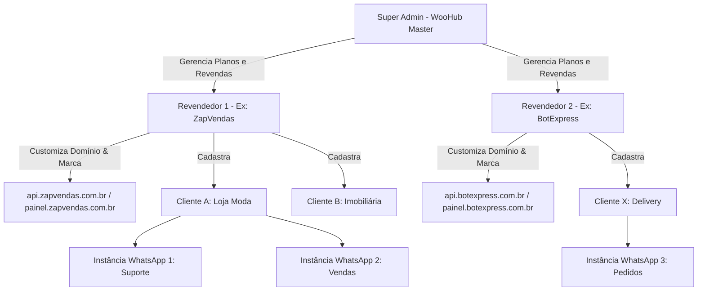

# WooHub API - Plano Diretor de Arquitetura & Especificação White-Label

> **Motor Base:** [whatsmeow](https://github.com/tulir/whatsmeow) (Go / Web Multidevice / Libsignal)  
> **Modelo de Negócio:** B2B SaaS de WhatsApp Gateway com suporte completo a Marca Própria (White-label) e Revenda  
> **Mercado:** 100% Brasil (PT-BR nativo, validação de nono dígito, conversão de áudio OGG Opus PTT, fuso horário Brasília)

---

## 1. Diagnóstico do Repositório Atual

### 1.1 O que já temos (whatsmeow)
O repositório atual contém a biblioteca pura `go.mau.fi/whatsmeow` criada por Tulir. Ela é considerada o **motor mais estável, performático e econômico** do mercado para WhatsApp:
- **Consumo de Memória:** ~15 MB a 35 MB de RAM por instância ativa (contra 400 MB - 1 GB de soluções baseadas em Chromium/Puppeteer como WPPConnect ou Baileys sem otimização).
- **Protocolo Direto:** Conexão binária nativa via WebSocket com criptografia Noise e Signal Protocol (`go.mau.fi/libsignal`).
- **Recursos Nativos:**
  - Pareamento via QR Code e Pairing Code (código de 8 dígitos sem câmera).
  - Envio e recebimento de mensagens de texto, mídias (áudio, vídeo, imagem, documentos, stickers), localização, contatos e reações.
  - Sincronização de histórico (`appstate`) e recibos de leitura/entrega.
  - Gestão de grupos, permissões e convites.
  - Armazenamento de sessão via `sqlstore` (SQLite3 e PostgreSQL já suportados no core da lib).

### 1.2 O que falta construir para virar a "WooHub API"
O whatsmeow é apenas uma biblioteca Go, não um servidor de produção nem uma plataforma comercial. Para transformar em um produto SaaS e-revenda White-label, precisamos construir:

| Camada | Componente Faltante | Descrição & Responsabilidade |
| :--- | :--- | :--- |
| **Gateway REST & WS** | Servidor HTTP em Go (Fiber v2 / Gin) | Roteador de alta performance para gerenciar instâncias, disparar mensagens e receber comandos |
| **Gerenciador de Instâncias** | `InstanceManager` em memória | Controlar o ciclo de vida (iniciar, pausar, reiniciar, desconectar, auto-reconexão inteligente) |
| **Multi-tenancy & White-label** | Modelo de Dados & Middleware | Separação estrita por Revendedor (Tenant) e Cliente Final; resolução dinâmica de marca por Domínio/Host |
| **Tratamento Brasil (PT-BR)** | Normalizador de Contatos & Áudio | Tratamento do 9º dígito brasileiro (+55), fallback inteligente, conversão de áudio para formato PTT gravado na hora |
| **Mensageria & Webhooks** | Fila Assíncrona & Dispatcher | Disparo de webhooks com retentativas exponenciais, logs de entrega e simulador |
| **Painel de Gestão (UI)** | Frontend Web Responsivo (React/Vite) | Painel completo para revendedores e clientes finais com personalização de logo, cores e domínio |
| **Proteção & Aquecimento** | Motor Anti-Bloqueio | Delays humanizados, filas de cadência e rotinas de aquecimento de chips (warmup) |

---

## 2. Arquitetura Multitenant & White-Label

A WooHub API foi desenhada com 3 níveis hierárquicos:



### 2.1 Identificação Dinâmica de Marca (Tenant Resolver)
Ao receber qualquer requisição HTTP ou acesso ao painel:
1. O Middleware inspeciona o cabeçalho `Host` (ex: `painel.suaempresa.com.br` ou `api.suaempresa.com.br`).
2. Localiza as configurações do revendedor no banco/cache Redis:
   - Nome da Empresa / Marca
   - URL do Logotipo (Claro / Escuro)
   - Favicon
   - Paleta de Cores Primária e Secundária (injetada via variáveis CSS `--primary-color`, etc.)
   - Links de Termos de Uso, Política de Privacidade e Suporte
   - Endpoints de Webhook padrão
3. Se não houver domínio customizado, aplica a marca padrão **WooHub API**.

---

## 3. Especificação do Banco de Dados (PostgreSQL)

```sql
-- 1. Revendedores / Tenants (White-label)
CREATE TABLE revendedores (
    id UUID PRIMARY KEY DEFAULT gen_random_uuid(),
    nome_empresa VARCHAR(150) NOT NULL,
    slug VARCHAR(50) UNIQUE NOT NULL,
    dominio_personalizado VARCHAR(150) UNIQUE,
    logo_url TEXT,
    favicon_url TEXT,
    cor_primaria VARCHAR(7) DEFAULT '#00C853',
    cor_secundaria VARCHAR(7) DEFAULT '#1E293B',
    limite_instancias INT DEFAULT 10,
    ativo BOOLEAN DEFAULT TRUE,
    criado_em TIMESTAMP WITH TIME ZONE DEFAULT NOW()
);

-- 2. Clientes Finais dos Revendedores
CREATE TABLE clientes (
    id UUID PRIMARY KEY DEFAULT gen_random_uuid(),
    revendedor_id UUID REFERENCES revendedores(id) ON DELETE CASCADE,
    nome VARCHAR(150) NOT NULL,
    email VARCHAR(150) UNIQUE NOT NULL,
    senha_hash VARCHAR(255) NOT NULL,
    documento_cpf_cnpj VARCHAR(20),
    limite_instancias INT DEFAULT 2,
    ativo BOOLEAN DEFAULT TRUE,
    criado_em TIMESTAMP WITH TIME ZONE DEFAULT NOW()
);

-- 3. Instâncias de WhatsApp (whatsmeow)
CREATE TABLE instancias (
    id UUID PRIMARY KEY DEFAULT gen_random_uuid(),
    cliente_id UUID REFERENCES clientes(id) ON DELETE CASCADE,
    nome_instancia VARCHAR(100) NOT NULL,
    chave_api VARCHAR(64) UNIQUE NOT NULL,
    jid VARCHAR(50),
    numero_telefone VARCHAR(20),
    status VARCHAR(30) DEFAULT 'DESCONECTADO', -- DESCONECTADO, GERANDO_QR, AGUARDANDO_LEITURA, CONECTADO
    webhook_url TEXT,
    webhook_eventos TEXT[], -- ['mensagem_recebida', 'status_envio', 'conexao']
    webhook_segredo VARCHAR(64),
    ignorar_grupos BOOLEAN DEFAULT FALSE,
    rejeitar_chamadas BOOLEAN DEFAULT FALSE,
    mensagem_chamada_rejeitada TEXT,
    criado_em TIMESTAMP WITH TIME ZONE DEFAULT NOW(),
    atualizado_em TIMESTAMP WITH TIME ZONE DEFAULT NOW()
);

-- 4. Logs de Mensagens & Auditoria
CREATE TABLE logs_mensagens (
    id UUID PRIMARY KEY DEFAULT gen_random_uuid(),
    instancia_id UUID REFERENCES instancias(id) ON DELETE CASCADE,
    mensagem_id VARCHAR(100),
    tipo VARCHAR(20), -- texto, imagem, audio, documento, video
    destinatario VARCHAR(30) NOT NULL,
    direcao VARCHAR(10) NOT NULL, -- ENVIADA, RECEBIDA
    status VARCHAR(20) DEFAULT 'ENVIANDO', -- ENVIANDO, ENTREGUE, LIDA, ERRO
    detalhes_erro TEXT,
    criado_em TIMESTAMP WITH TIME ZONE DEFAULT NOW()
);
```

---

## 4. Endpoints Principais da API (100% Brasil / PT-BR)

Todas as rotas são protegidas por autenticação via Header `x-api-key: {chave_instancia}` ou Bearer Token JWT.

### 4.1 Gestão de Instâncias
- `POST /api/v1/instancia/criar`: Cria nova instância com nome e configurações de webhook.
- `GET /api/v1/instancia/{id}/conectar`: Inicia o cliente whatsmeow e abre o canal de QR Code.
- `GET /api/v1/instancia/{id}/qrcode`: Retorna o QR Code em Base64 ou Streaming SSE / WebSocket.
- `POST /api/v1/instancia/{id}/codigo-pareamento`: Gera código numérico de 8 dígitos para celular sem câmera.
- `POST /api/v1/instancia/{id}/desconectar`: Desconecta da sessão do WhatsApp sem apagar os dados.
- `DELETE /api/v1/instancia/{id}/apagar`: Remove a instância e limpa as chaves criptográficas do banco.
- `GET /api/v1/instancia/{id}/status`: Retorna o estado atual (`CONECTADO`, `DESCONECTADO`, etc.), nível de bateria e número conectado.

### 4.2 Envio de Mensagens
- `POST /api/v1/mensagem/texto`: Envia texto simples com suporte a emojis, formatações e menções.
- `POST /api/v1/mensagem/audio`: Envia áudio com transcodificação automática para OGG Opus no modo **PTT** (aparece gravado na hora com microfone verde).
- `POST /api/v1/mensagem/midia`: Envia fotos, vídeos, figurinhas (stickers estáticos ou animados) e documentos (PDF, planilhas).
- `POST /api/v1/mensagem/contato`: Compartilha vCard(s) formatado(s).
- `POST /api/v1/mensagem/localizacao`: Envia coordenadas geográficas com nome do local.
- `POST /api/v1/mensagem/reacao`: Reage a uma mensagem existente com emoji.

### 4.3 Gestão de Grupos
- `POST /api/v1/grupo/criar`: Cria grupo com participantes e foto de perfil.
- `GET /api/v1/grupo/{jid}/participantes`: Lista membros e administradores.
- `POST /api/v1/grupo/{jid}/adicionar`: Adiciona participantes.
- `POST /api/v1/grupo/{jid}/link-convite`: Obtém ou redefine o link de convite.

---

## 5. Particularidades do Mercado Brasileiro (Regras Brasil)

1. **Validação do Nono Dígito (+55):**
   - No Brasil, números móveis têm o formato `+55 (DD) 9XXXX-XXXX`.
   - Contudo, contas antigas ou números corporativos podem estar registrados no WhatsApp com ou sem o `9`.
   - O motor WooHub possui verificação nativa via `IsOnWhatsApp` do whatsmeow: se o envio para o número com 9 falhar ou não existir, o sistema tenta automaticamente o formato de 8 dígitos antes de reportar erro.
2. **Áudio Gravado na Hora (PTT):**
   - Clientes brasileiros valorizam muito áudios que soam gravados naturalmente.
   - O WooHub integra transcodificação via biblioteca Go nativa (`hraban/opus` ou ffmpeg) garantindo saída `audio/ogg; codecs=opus` com a flag `PTT: true`.
3. **Formatos Financeiros e Fuso Horário:**
   - Moeda padrão: BRL (R$).
   - Relatórios e logs registrados no fuso `America/Sao_Paulo`.

---

## 6. Fases de Implementação Recomendadas

- **Fase 1: Núcleo do Servidor (Go Fiber + whatsmeow Manager)**  
  Implementar o wrapper em Go com gerenciamento de múltiplas instâncias em memória e banco de dados SQLite/PostgreSQL.
- **Fase 2: Motor de White-Label & Multi-tenancy**  
  Implementar middlewares de roteamento de domínios, autenticação JWT, chaves de API e isolamento de dados.
- **Fase 3: Painel Web de Gestão (Dashboard)**  
  Construir a interface visual moderna em português brasileiro com suporte a temas dinâmicos (cores e logos da revenda).
- **Fase 4: Motor de Webhooks e Transcodificação de Mídias**  
  Fila com retentativas, normalizador de telefones BR e conversor de áudio PTT.
- **Fase 5: Documentação Swagger Interativa & Empacotamento Docker**  
  Documentação 100% em português com Swagger UI e Docker Compose pronto para deploy de alta disponibilidade.
